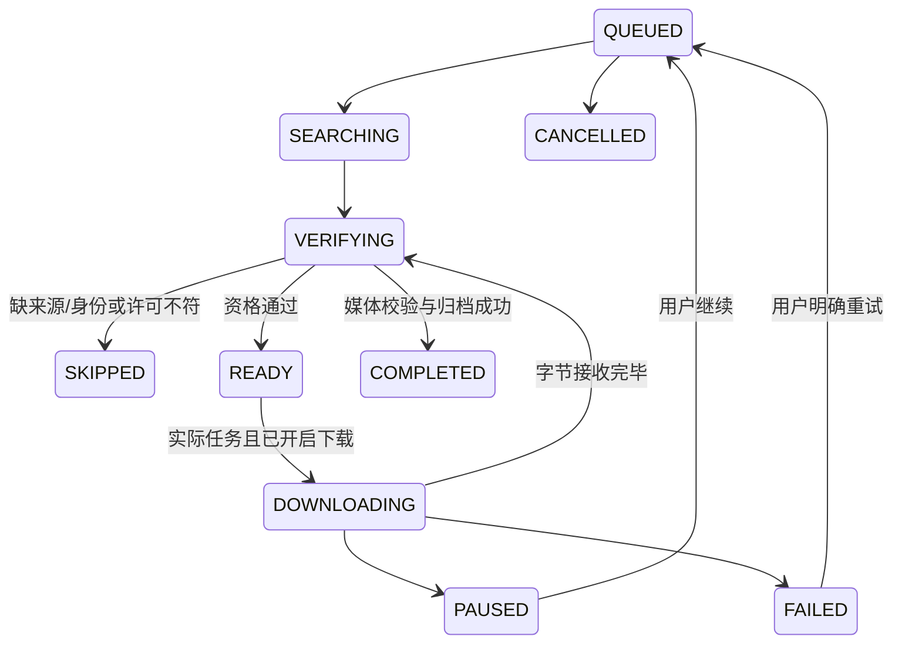

# Phase 3B 下载引擎报告

本轮扩展现有项目，保留 Song / Recording / Work、人工审核、统一搜索及 SourceSearchEngine。默认 dry-run，不创建媒体文件。用户在“下载设置”保存实际下载开关后，重新建立实际任务并点击开始；开启设置本身不会启动任务，也不会把旧 dry-run 自动变成下载。

## 模块与调用边界

| 文件 | 职责 |
|---|---|
| `downloads/models.py` | DownloadCandidate、DownloadSettings、状态和错误类型 |
| `downloads/targets.py` | 从明确歌手/录音构造不可变任务快照，保留版本、ISRC、已选搜索别名、原始元数据和确认来源 |
| `downloads/eligibility.py` | DownloadEligibilityService：重新核对官方文件、录音身份、许可和完整性 |
| `downloads/manager.py` | DownloadManager：队列、并发、控制、恢复、HTTP传输、原子归档、来源文件锁 |
| `downloads/files.py` | Windows名称、边界、空间、字节/哈希/媒体校验与不覆盖发布 |
| `downloads/security.py` | 固定HTTPS来源、公共IP、连接时DNS固定、受控重定向、HTTP验证器 |
| `downloads/worker.py` | Qt后台适配，批量建立任务与执行队列 |
| `database/downloads.py` | 任务/证据/尝试/已核实文件/设置持久化 |
| `privacy.py` | 来源候选和下载证据的已知凭据及签名URL参数过滤 |
| `ui/download_page.py` / `download_settings.py` | 下载页、设置页、真实状态与可读授权证据 |

UI → DownloadWorker → DownloadManager（有界线程池）→ 原 SourceSearchEngine / DownloadEligibilityService → 独立音频HTTP客户端 → 文件校验 → 归档。下载领域不导入Qt；只有worker/UI导入Qt。没有播放器、歌词、歌单、Drive、阿里云盘或Phase3C功能。原`downloads/__init__.py`及云端占位保持不变。

## 身份和下载资格

DownloadCandidate保存要求中的歌曲/录音ID、歌手、标题、版本、provider、页面和下载URL、格式、大小、时长、许可状态/名称/链接、下载与私人保存许可、匹配/完整性状态、置信度、原因、核验时间；额外保存文件ID、校验值、署名、限制、目标快照及官方原始证据。

- 旧`METADATA_MATCH`分数、歌曲确认、搜索网页或下载按钮都不颁发下载资格。
- 已确认MusicBrainz录音需要精确官方文件URL关系，或官方Recording ISRC与文件明确ISRC一致并有一致标题；已知演唱署名、版本和时长冲突会拒绝。仅标题/时长接近不通过。不改写原作品归并或人工审核。
- 对明确选择的来源原生录音，文件ID/页面必须一致，使用单独namespace；不伪造MusicBrainz UUID。本轮WAV控制样本走此路径，未把它加入MusicBrainz原始库。正常歌曲UI仍连接Phase3A已选择的Recording。
- Commons重新查询官方imageinfo，包括文件URL、音频类型、大小、SHA-1、时长及文件级CC许可；缺少署名、冲突/待审核标记、限制或无法核实者不通过。
- Jamendo需要自己的client_id、最新`audiodownload_allowed=true`、明确CC许可及可靠录音关联；本轮未配置，未进行真实Jamendo下载。Archive上传者许可声明与Chrome页面仍不足以证明具体录音权利，保留候选并拒绝自动下载。
- 试听标记、与目标不符的时长或版本均拒绝；不会补静音、改帧、转码或写标签让片段通过。CC署名、非商业、禁止改编再分发或相同许可要求随文件保存。

许可判定的来源依据为[Commons文件复用说明](https://commons.wikimedia.org/wiki/Commons:Reusing_content_outside_Wikimedia)、[CC BY 3.0](https://creativecommons.org/licenses/by/3.0/)、[CC BY-SA 4.0](https://creativecommons.org/licenses/by-sa/4.0/)及[Jamendo下载标志说明](https://developer.jamendo.com/v3.0/tracks/file)。这是对具体来源元数据、关系和许可条件的审核，不是任意互联网音频的版权保证。

## 状态与持久化

dry-run到READY即停止；SKIPPED、LICENSE_UNVERIFIED、READY和PAUSED都不算归档成功。原因另存`NO_SOURCE`、`TARGET_UNCONFIRMED`、`RECORDING_MISMATCH`、`VERSION_MISMATCH`、`PREVIEW_ONLY`、`INCOMPLETE_AUDIO`、`LICENSE_UNVERIFIED`、`DOWNLOAD_NOT_PERMITTED`及实际网络/文件错误。未知总字节不伪造百分比，已收完字节但尚未归档时明确显示“字节/未归档”。

在v6基础上仅追加v7：`download_jobs`、`download_attempts`、`downloaded_files`、只追加的`download_evidence`和`download_settings`。任务保留歌手、Song/Recording、版本、来源提示及建立时设置；修改目录影响新任务，恢复旧任务沿用其原目录。v1–6校验和不变。

Windows进程锁防止同一队列被多个进程同时执行。线程池默认2、可设置1–4；同一provider/file ID还有独立锁，避免多个Song同时下载同一来源文件。总限速按队列字节分配，速度/ETA根据实际写入计算。自动重试默认最多3次、上限5；手动重试是明确的新有界周期，旧尝试和错误历史保留。

暂停/取消使用协作事件，限速/退避可中断；进行中的HTTP读取等待响应或超时。批量建立过程中收到暂停/取消，也会应用到后续条目。退出请求暂停，不删除目录数据；进程异常退出后，SEARCHING/VERIFYING/DOWNLOADING恢复为PAUSED。应用重启不自动执行，必须点击继续/开始。

## HTTP与续传

源元数据API沿用限速及退避；音频请求单独按来源限速，超时默认20秒。429/503等按有界退避和Retry-After等待；较长等待要求稍后手动重试。401停止认证受限下载；403/404/410仅能重新通过官方API核验地址，不通过浏览器、登录或隐藏流绕过。

`.part`位于所选根目录的`.parts/<job UUID>.part`。恢复时读取实际临时文件长度，不能只相信最后一次UI字节计数。仅在来源资源路径一致、存在标准强ETag或满足HTTP时间条件的Last-Modified时发送Range/If-Range。

- 206必须有正确起点、末尾、总量及一致验证器；拒绝错误范围和变化对象。
- 200表示重新从零写本任务临时文件，不把整文件拼到旧前缀后。
- 无可靠验证器、URL资源改变时重新下载。裸校验字符串和弱ETag不当成强ETag。
- 已完整接收且有官方校验值的临时文件仍需重新校验，不能靠临时扩展名标记成功。

采用[RFC 9110的范围请求及条件验证规则](https://www.rfc-editor.org/rfc/rfc9110.html)。早期真实Commons返回裸ETag，错误地作为If-Range时服务器返回200，已安全重下但**不是续传成功**；修正后使用足够旧且有Date佐证的Last-Modified，最终原生GUI和独立进程恢复均取得206。

## 归档与复用

默认根目录`E:\users\yliu\MelodyVault\.local\downloads`，可在设置中修改。目录为歌手/歌曲，文件名含版本、录音ID摘要和内容SHA摘要；非法字符、保留设备名、路径穿越、根目录外解析及过长路径拒绝。不覆盖不同内容，不删除用户已有文件。

传输前检查磁盘空间和文件上限（默认512MiB）；流式接收不超过官方/HTTP总大小。完整接收后核对官方SHA-1/可用校验值，计算SHA-256、MD5；mutagen按内容识别MP3/FLAC/WAV/Ogg/Opus/受支持MP4音频及实际时长，WAV额外分块核对声明采样数据。不以扩展名作为唯一证据。真实样本为MP3与PCM WAV；其他格式不是本轮真实下载验收样本。

验证成功才在同卷原子发布，写`.evidence.json`保存来源、署名、许可条件、原始字节未修改声明、格式、大小、时长和校验值，再以SQLite事务登记文件及COMPLETED。若最终发布/证据写入失败，不标完成；不删除已发布文件去“回滚”用户内容。

重复任务必须重新审核来源和许可，且校验现存文件；仅相同来源文件ID/版本校验信息才复用，不靠歌名去重。不同目录的新任务可复制已核实原始字节到新目录，保留旧文件，不重复网络下载。失败/取消临时文件按设置保留或清理；暂停文件保留以便恢复。

## 实测与边界

真实MP3/WAV文件、SHA-256、耗时、206、实际进程中断和GUI证据见[PHASE3B_VALIDATION.md](../validation/PHASE3B_VALIDATION.md)。真实UI已验证默认dry-run、明确开启、新建实际任务、暂停、重建窗口、继续、完成和授权证据。三位商业歌手各5首仅搜索/审核，不要求找到原唱，不符合资格时跳过。

文件校验为官方字节/校验值及媒体结构/时长解析，没有逐帧解码或声纹识别。社区元数据不完整或冲突时会减少可下载覆盖率。平台例外、未知CDN重定向、未知许可和访问控制均不自动放宽；Archive/Jamendo限制见安全报告。Windows11、其他Python版本、UNC/可移动盘断开、无Python独立exe未在本轮验收。

本轮不创建任何云端上传、播放器或Phase3C工作。

最终全量回归169 passed/301.97秒（`pytest-verified.xml`），包含原113项和新增56项；失败记录与真实/模拟区别见验收报告。
